# Déjà View

*Never forget why you loved it.*

A movie-tracking app that goes beyond a plain watchlist: rate and review what you've watched, get recommendations that actually understand your taste, and share movies with friends along with why you think they'll like them.

## Screenshots

<table>
<tr>
<td align="center">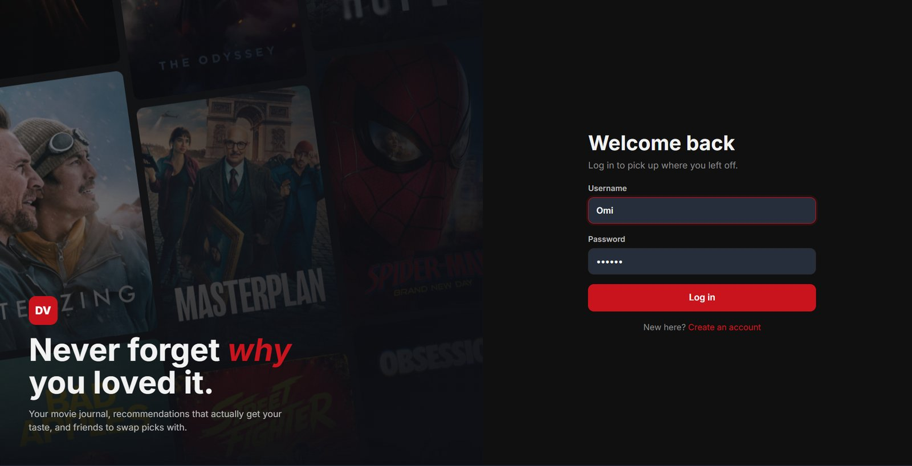<br/><sub>Log in</sub></td>
</tr>
<tr>
<td align="center">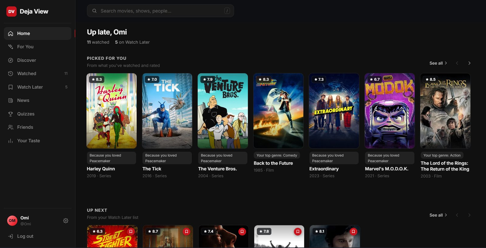<br/><sub>Home: personalised picks, each with the reason it was chosen</sub></td>
</tr>
<tr>
<td align="center">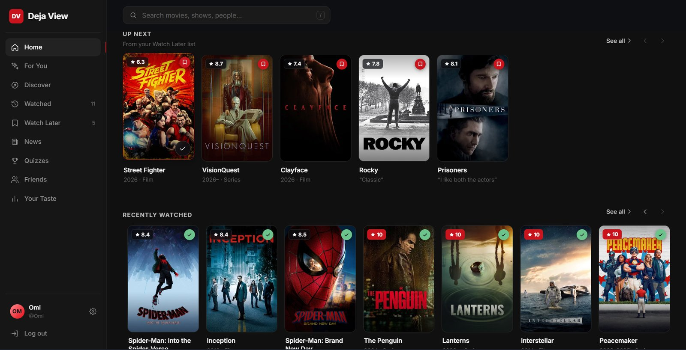<br/><sub>Home: Up next from your Watch Later list, and recently watched</sub></td>
</tr>
<tr>
<td align="center">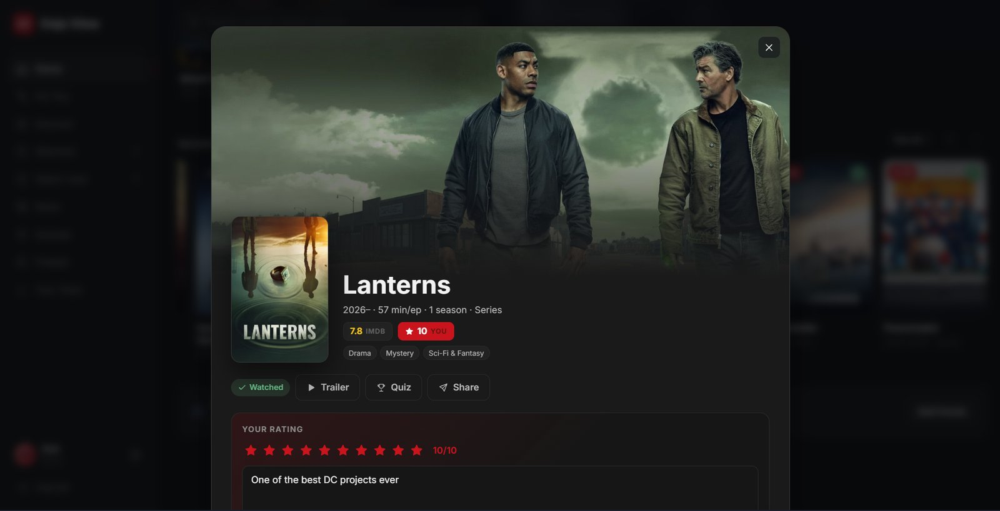<br/><sub>Title view: your rating and review, trailer, quiz and share</sub></td>
</tr>
<tr>
<td align="center">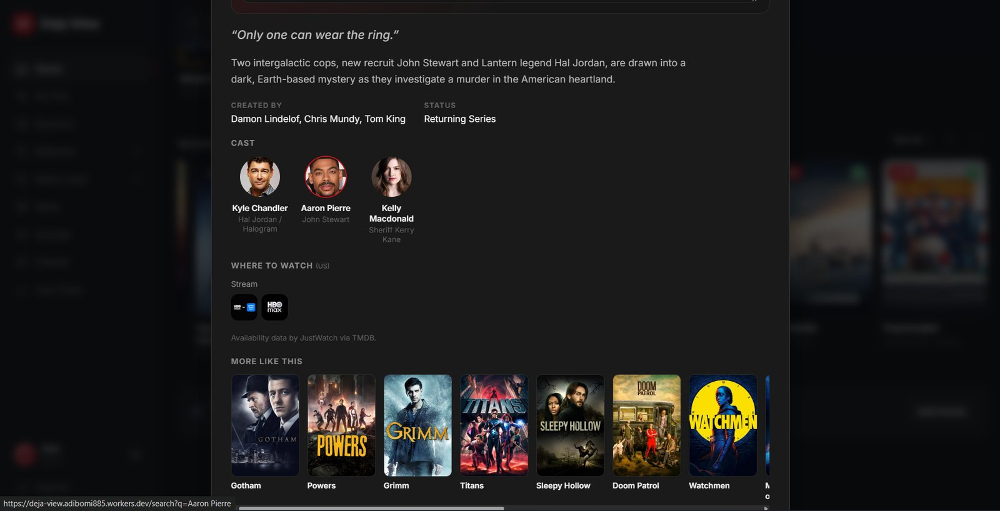<br/><sub>Title view: cast, where to watch, and more like this</sub></td>
</tr>
<tr>
<td align="center">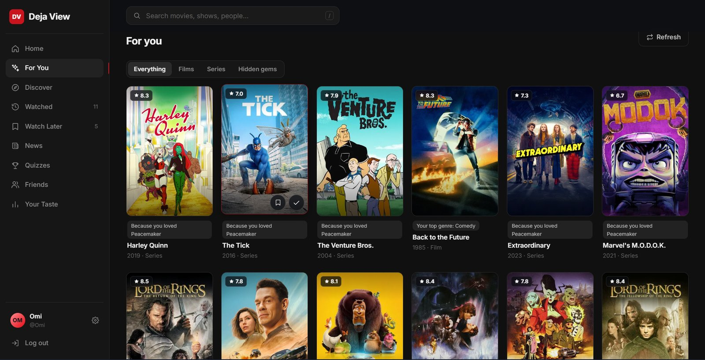<br/><sub>For You: recommendations filtered by films, series or hidden gems</sub></td>
</tr>
<tr>
<td align="center">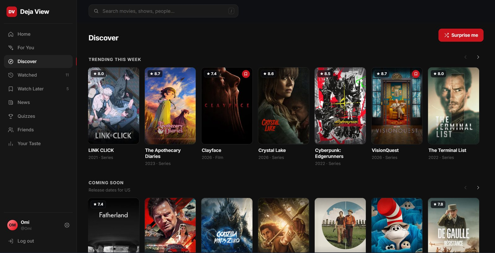<br/><sub>Discover: Surprise me, trending this week and coming soon</sub></td>
</tr>
<tr>
<td align="center">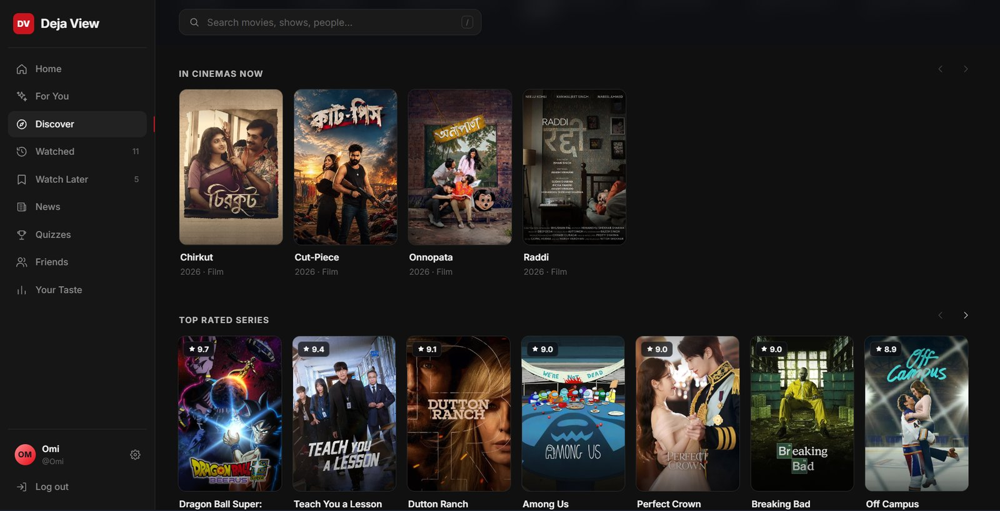<br/><sub>Discover: in cinemas now and top rated series</sub></td>
</tr>
<tr>
<td align="center">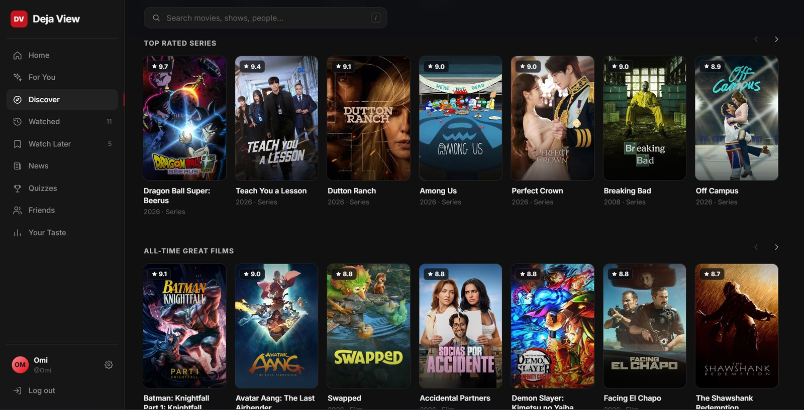<br/><sub>Discover: all-time great films</sub></td>
</tr>
<tr>
<td align="center">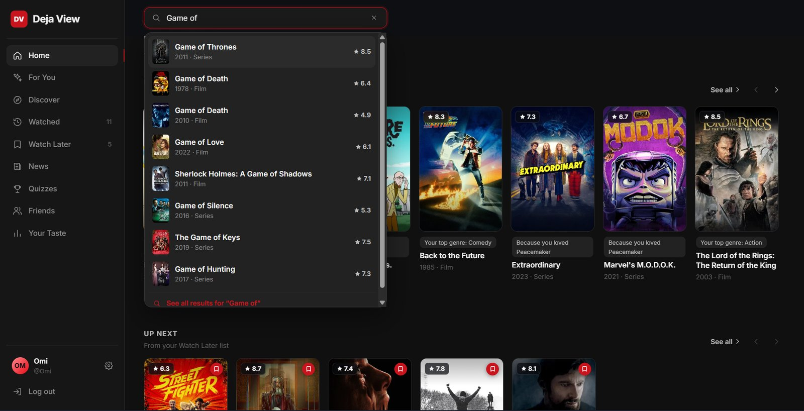<br/><sub>Instant search suggestions as you type</sub></td>
</tr>
<tr>
<td align="center">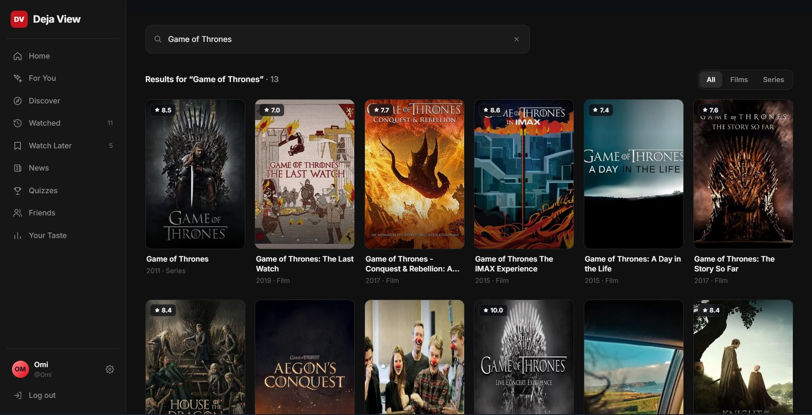<br/><sub>Full search results</sub></td>
</tr>
<tr>
<td align="center">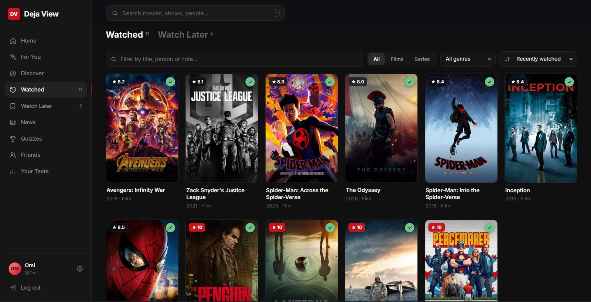<br/><sub>Watched list with filters and sorting</sub></td>
</tr>
<tr>
<td align="center">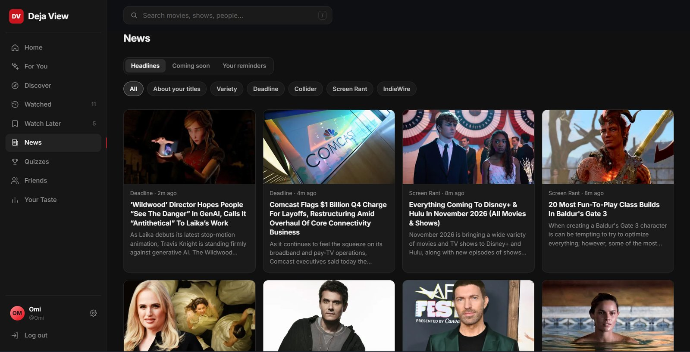<br/><sub>News: film and TV headlines, filterable by source or by titles in your library</sub></td>
</tr>
<tr>
<td align="center">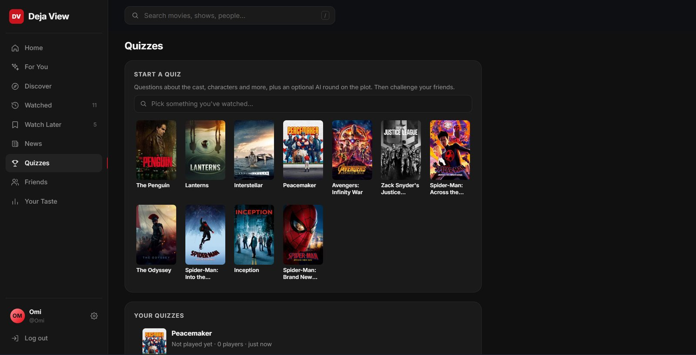<br/><sub>Quizzes: pick something you've watched to start a quiz</sub></td>
</tr>
<tr>
<td align="center">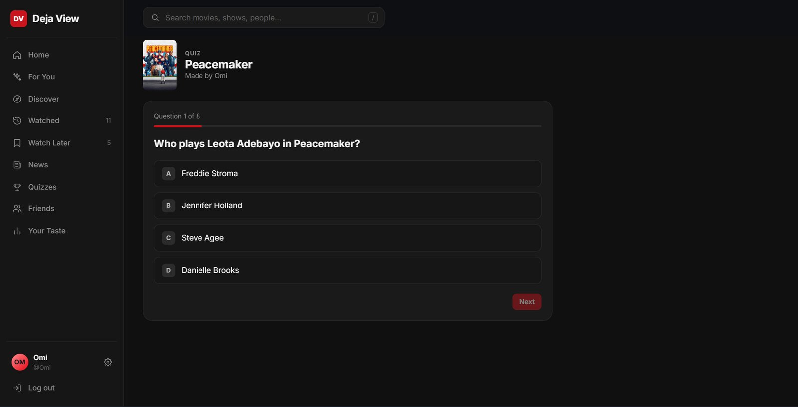<br/><sub>Taking a quiz</sub></td>
</tr>
<tr>
<td align="center">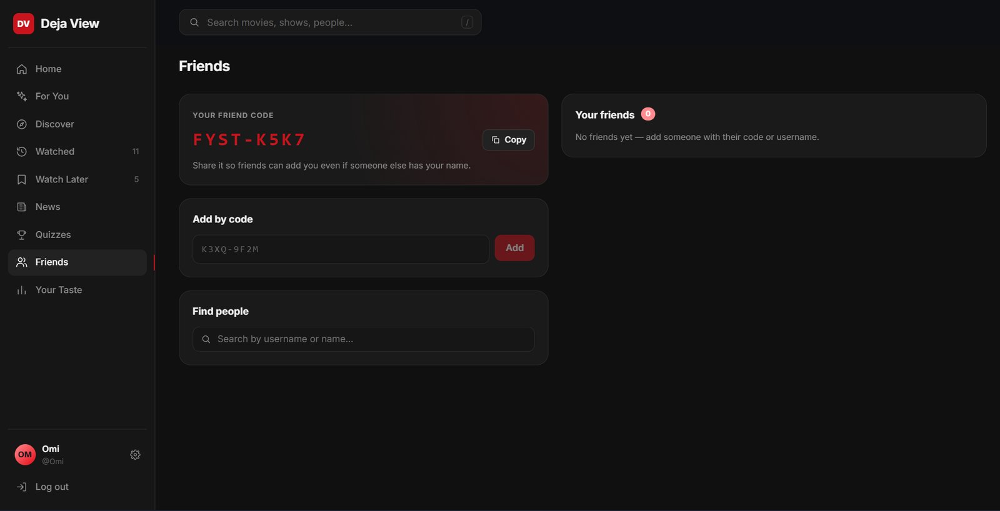<br/><sub>Friends: share your friend code or find people by name</sub></td>
</tr>
<tr>
<td align="center">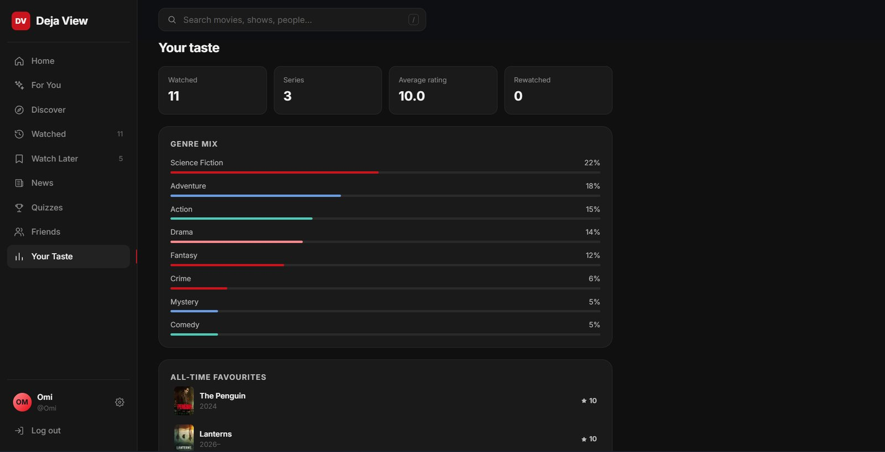<br/><sub>Your Taste: stats, genre mix and all-time favourites</sub></td>
</tr>
</table>

> Recommendations are generated live from each user's own ratings, so they differ for every account and change as you rate more.

## Features

### Track what you watch
- **Search** any movie, show, actor, director or genre with instant as-you-type suggestions (press <kbd>/</kbd> anywhere to jump to search).
- Add titles to **Watched** or **Watch Later** in one click, straight from any poster.
- Rate watched titles with a 10-star picker and keep a personal review; leave a note on Watch Later items explaining why you want to see them.
- **Rewatch tracking** — log every time you watch something again.
- A full title view with backdrop, cast, director, runtime, IMDb rating, **trailer**, **where to stream / rent / buy in your country** (JustWatch data via TMDB) and "More like this".
- Watched and Watch Later pages with filtering (text, film/series, genre) and sorting (rating, date, year, title, most rewatched).
- Remove anything with one-click **Undo**.

### Recommendations that are actually precise
- **Because-you-liked-X** picks built from TMDB's recommendation graph for the titles you've watched, weighted by how highly you rated them, plus more from the directors behind your favourites.
- Re-ranked by your **genre taste profile**, quality, and a diversity pass so one favourite doesn't take over. Each pick explains *why* it's there, and **hidden gems** get flagged.
- Brand new accounts get picks seeded from the genres chosen during onboarding.
- **Discover**: trending this week, coming soon (for your region), in cinemas and top rated, plus a **Surprise me** button that opens a random pick you haven't seen.
- **Your Taste**: stats, your genre mix and all-time favourites.

### News & reminders
- **Headlines** from Variety, Deadline, Collider, Screen Rant and IndieWire, filterable by source or to stories about titles in your library.
- **Coming soon**: upcoming films and new series with a **Remind me** button (returning series remind on their next episode).
- When a reminded title comes out, an "Out now" strip appears on Home.

### Quizzes
- Quiz yourself on anything you've watched: questions on cast, characters, director, release year and more, plus an optional **AI-written plot round**.
- **Challenge friends**: everyone gets the same questions, only first attempts count, and a leaderboard ranks you against friends.

### Friends & sharing
- Add friends by username search or by your unique **friend code**; requests need acceptance (and can be cancelled).
- Share any title — from your lists, search or recommendations — with one or more friends, with a note on why.
- Shared titles land in a "Shared with you" inbox; one click adds them to Watch Later.
- Full sharing history with each friend. Your lists stay private.

### Accounts
- Signup/login with salted PBKDF2 password hashing and JWT sessions; change password; edit display name and favourite genres.
- **Export all your data** as JSON and **delete your account** from the profile page.

## Tech stack

**Frontend:** React 19, React Router, Vite — plain CSS design system
**Backend:** Cloudflare Workers ([Hono](https://hono.dev)) + Cloudflare D1 (SQLite)
**Hosting:** a single Cloudflare Worker serves both the API (`/api/*`) and the static app
**External APIs:** [TMDB](https://www.themoviedb.org/documentation/api) (catalogue, search, recommendations, providers), [OMDb](https://www.omdbapi.com/) (IMDb ratings)

### Why it's fast
- No cold starts — Workers run at the edge, next to the user.
- Search and recommendations use TMDB data directly (one or two parallel calls) instead of hydrating every result through OMDb; TMDB responses are memoised in the isolate and cached at Cloudflare's edge.
- The whole library, friends list and inbox load in **one request / one D1 batch**; every change after that is optimistic (the UI updates instantly and reconciles in the background).
- Recommendations, discover rows and search results are cached client-side (stale-while-revalidate), so revisiting a page is instant.

## Getting started

Requirements: Node 20+, a free [Cloudflare account](https://dash.cloudflare.com/sign-up), TMDB + OMDb API keys.

```bash
npm install                 # installs the API deps and the frontend (postinstall)
```

Create a `.dev.vars` file in the repo root (git-ignored) with your secrets:

```
TMDB_API_KEY=your_tmdb_key
OMDB_API_KEY=your_omdb_key
JWT_SECRET=any_long_random_string
ANTHROPIC_API_KEY=your_anthropic_key   # optional: AI plot round in quizzes
```

Create the local database and run:

```bash
npm run db:migrate:local    # creates the D1 tables locally
npm run dev:api             # Worker API on http://127.0.0.1:8787
npm run dev:web             # Vite on http://localhost:5173 (hot reload, proxies /api to the Worker)
```

`npm run dev` instead builds the frontend once and serves everything from the Worker on :8787.

## Deploying to Cloudflare Workers

Cloudflare builds and deploys from GitHub on every push to `master` (Workers Builds).

1. Create the database (once): `npx wrangler login`, then
   `npx wrangler d1 create deja-view --location apac`. Paste the printed id into `database_id` in
   [wrangler.jsonc](wrangler.jsonc), and run `npm run db:migrate:remote` to create the tables.
2. Commit and push to GitHub.
3. In the Cloudflare dashboard: **Workers & Pages → Create → Workers → Import a repository**, pick the
   repo, keep the project name `deja-view` (it must match `name` in wrangler.jsonc), and set build command
   `npm run build`, deploy command `npx wrangler deploy`.
4. After the first deploy, add `TMDB_API_KEY`, `OMDB_API_KEY`, `JWT_SECRET` (and optionally
   `ANTHROPIC_API_KEY`) under **Settings → Variables and Secrets** as type **Secret**.

The app is live at `https://deja-view.<your-subdomain>.workers.dev`; add your own domain under
**Settings → Domains & Routes**. When a change adds a migration, run `npm run db:migrate:remote` before pushing it.
Manual deploys from your machine still work with `npm run deploy`.

### Migrating data from the old Render/Postgres backend

[scripts/migrate_postgres_to_d1.py](scripts/migrate_postgres_to_d1.py) exports users (password hashes
included — everyone keeps their password), libraries, friendships and shares, and backfills TMDB ids:

```bash
backend/venv/Scripts/python.exe scripts/migrate_postgres_to_d1.py --database-url "<Render External Database URL>"
npx wrangler d1 execute deja-view --remote --file=scripts/d1_import.sql
```

Old bcrypt hashes are verified once on first login and transparently upgraded.

## Project structure

```
wrangler.jsonc             # Worker + D1 + static assets config
worker/
  src/index.js             # Hono app: auth middleware, routing, errors
  src/routes/              # account, library, catalog, recs, social, news (RSS/upcoming/reminders), quiz
  src/tmdb.js              # TMDB/OMDb client, caching, card normalisation
  src/auth.js              # PBKDF2 (+ legacy bcrypt) hashing, JWT, friend codes
  migrations/              # D1 schema
frontend/
  src/pages/               # Home, For You, Discover, Search, Watched/Watch Later, Friends, Profile, auth
  src/components/          # PosterCard, Row, TitleModal, SearchBox, Layout, RatingInput…
  src/context/             # Auth, Library (optimistic store), TitleModal, Toast, Confirm
  src/lib/                 # SWR cache, formatting helpers
scripts/                   # Postgres → D1 migration
backend/                   # Legacy FastAPI backend (kept for reference, no longer deployed)
```
