# Déjà View

*Never forget why you loved it.*

A movie-tracking app that goes beyond a plain watchlist: rate and review what you've watched, get recommendations that actually understand your taste, and share movies with friends along with why you think they'll like them.

## Screenshots

<table>
<tr>
<td align="center">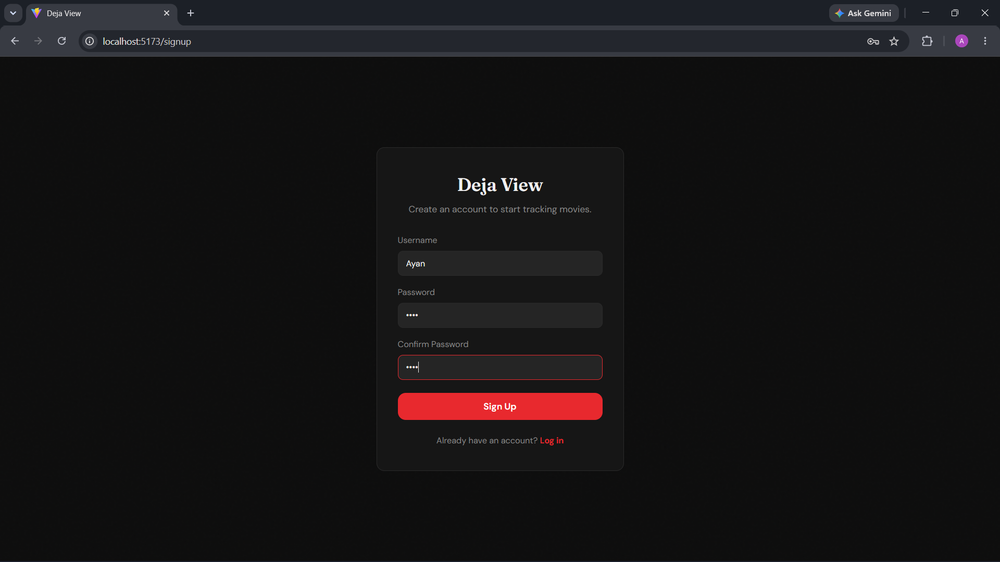<br/><sub>Sign up</sub></td>
</tr>
<tr>
<td align="center">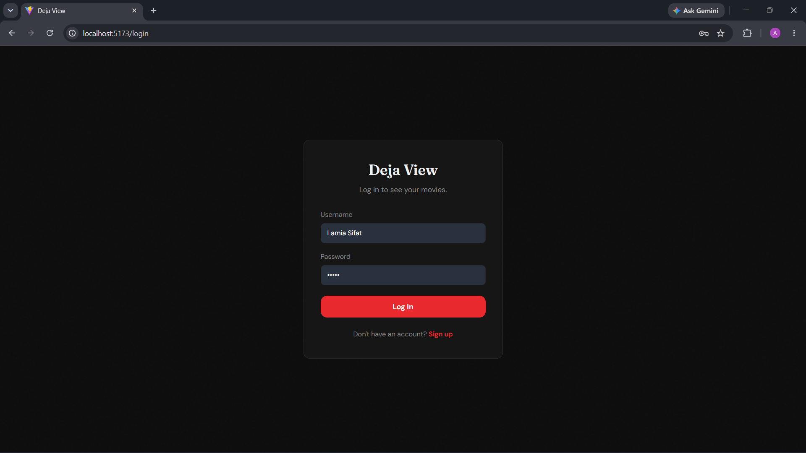<br/><sub>Log in</sub></td>
</tr>
<tr>
<td align="center">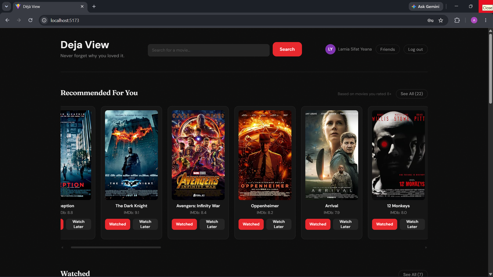<br/><sub>Home — recommendations, Watched, Watch Later</sub></td>
</tr>
<tr>
<td align="center">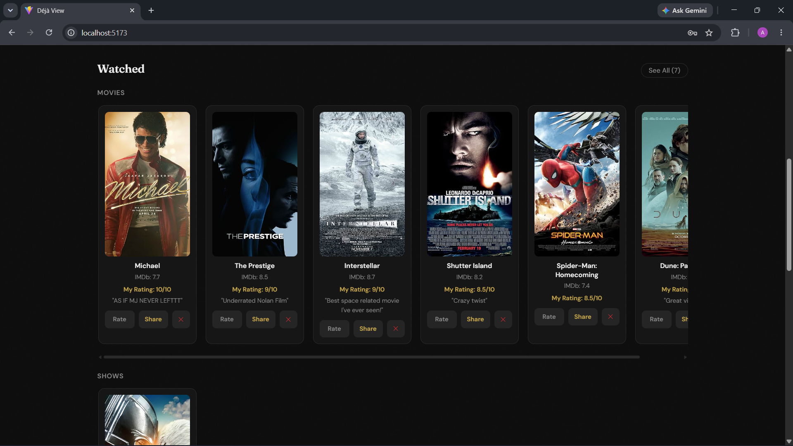<br/><sub>Watched list</sub></td>
</tr>
<tr>
<td align="center">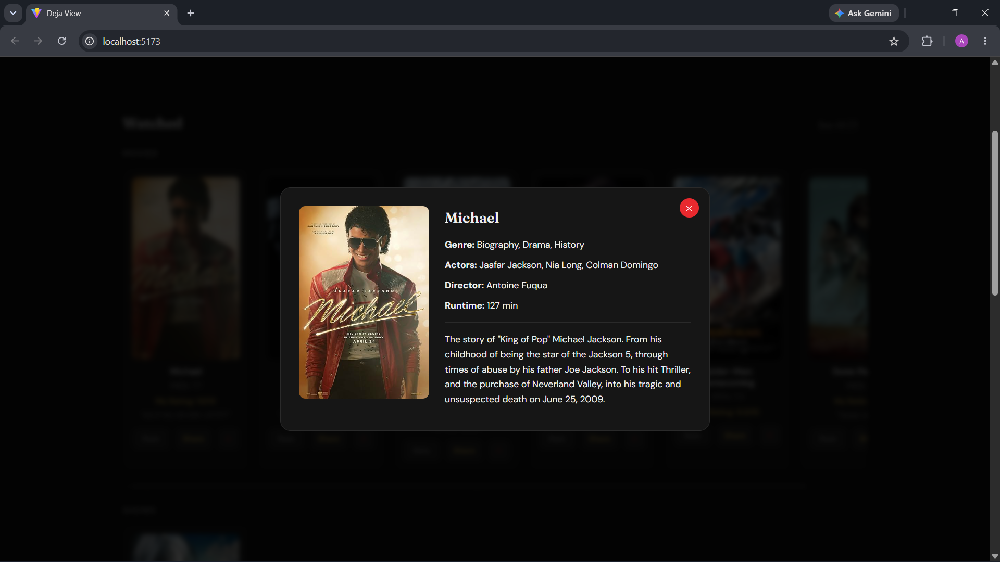<br/><sub>Movie detail view</sub></td>
</tr>
<tr>
<td align="center">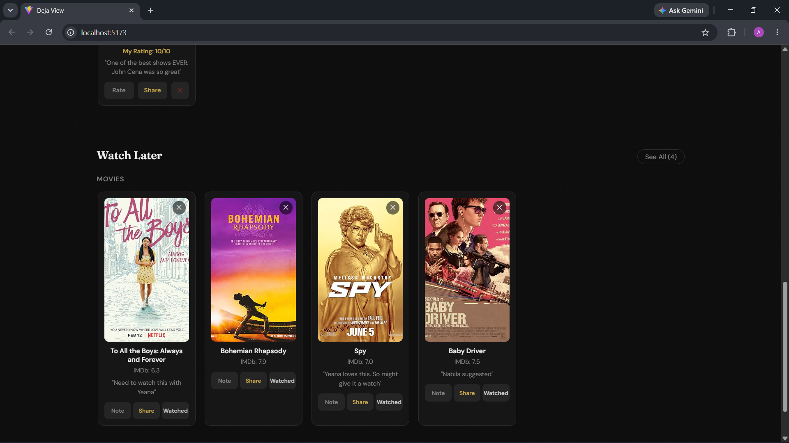<br/><sub>Watch Later list</sub></td>
</tr>
<tr>
<td align="center">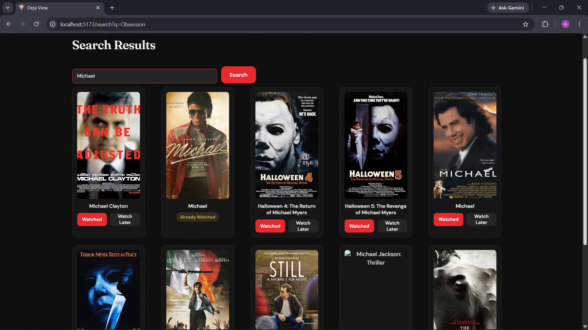<br/><sub>Search results</sub></td>
</tr>
<!-- <tr>
<td align="center">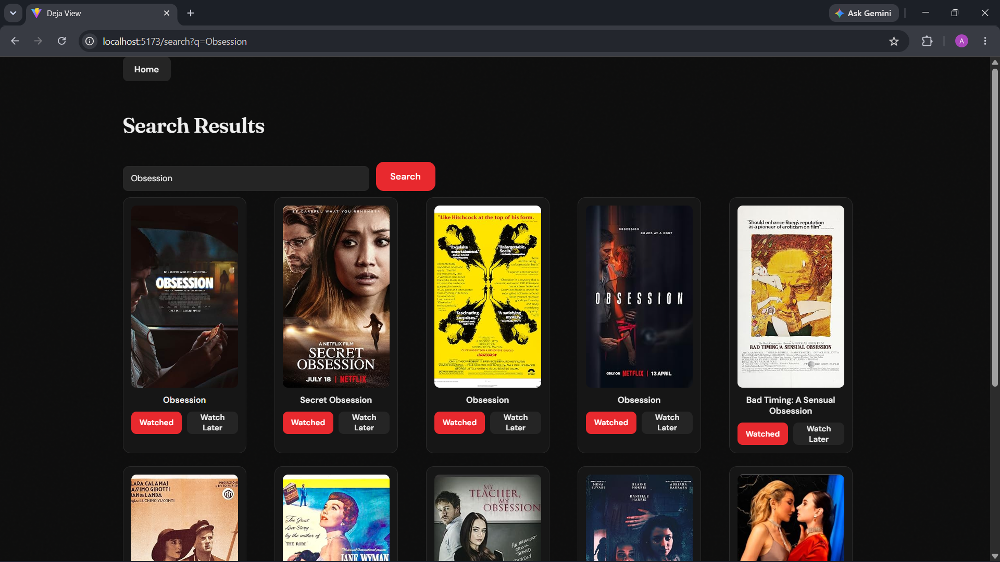<br/><sub>Search results</sub></td>
</tr> -->
<tr>
<td align="center">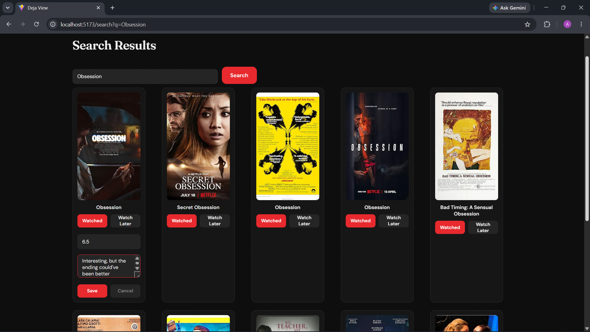<br/><sub>Adding a rating and review from search results</sub></td>
</tr>
<tr>
<td align="center">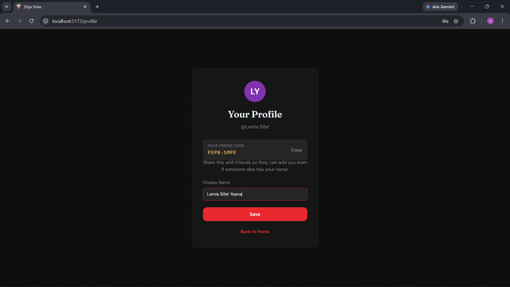<br/><sub>Profile</sub></td>
</tr>
<tr>
<td align="center">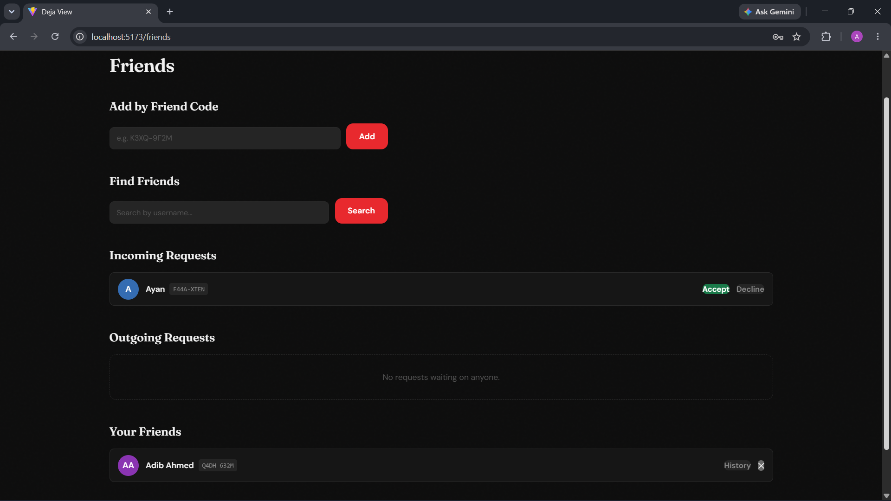<br/><sub>Friends</sub></td>
</tr>
<tr>
<td align="center">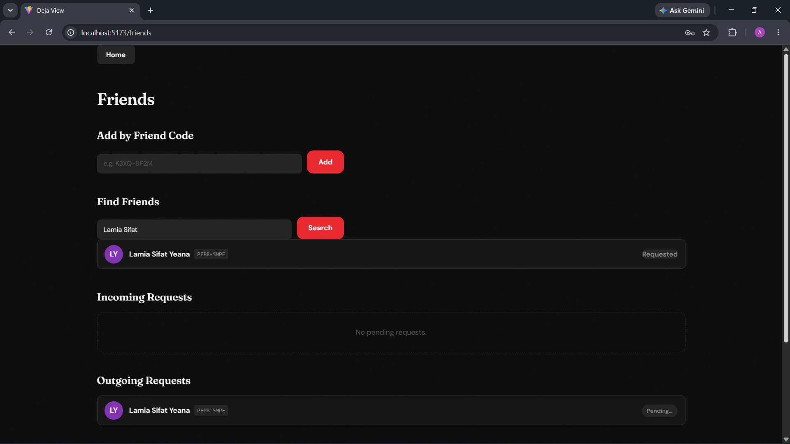<br/><sub>Adding a friend</sub></td>
</tr>
</table>

> The "Recommended For You" row is generated live from your own ratings, so it won't look like the screenshot above — it's different for every account and changes as you rate more movies.

## Features

### Track what you watch
- **Search** any movie, show, actor, director or genre with instant as-you-type suggestions (press <kbd>/</kbd> anywhere to jump to search).
- Add titles to **Watched** or **Watch Later** in one click, straight from any poster.
- Rate watched titles with a 10-star picker and keep a personal review; leave a note on Watch Later items explaining why you want to see them.
- **Rewatch tracking** — log every time you watch something again.
- A full title view with backdrop, cast, director, runtime, TMDB + IMDb ratings, **trailer**, **where to stream / rent / buy in your country** (JustWatch data via TMDB) and "More like this".
- Watched and Watch Later pages with filtering (text, film/series, genre) and sorting (rating, date, year, title, most rewatched).
- Remove anything with one-click **Undo**.

### Recommendations that are actually precise
- **Because-you-liked-X** picks built from TMDB's recommendation graph for the titles you've watched, weighted by how highly you rated them, plus more from the directors behind your favourites.
- Re-ranked by your **genre taste profile**, quality, and a diversity pass so one favourite doesn't take over. Each pick explains *why* it's there, and **hidden gems** get flagged.
- Brand new accounts get picks seeded from the genres chosen during onboarding.
- **Discover**: trending this week, coming soon (for your region), in cinemas, top rated — and **mood picks** (feel-good, mind-bending, tearjerker…) with a **Surprise me** button.
- **Dashboard** with stats, your taste profile and all-time favourites.

### Friends & sharing
- Add friends by username search or by your unique **friend code**; requests need acceptance (and can be cancelled).
- Share any title — from your lists, search or recommendations — with one or more friends, with a note on why.
- Shared titles land in a "Shared with you" inbox; one click adds them to Watch Later.
- Full sharing history with each friend. Your lists stay private.

### Accounts
- Signup/login with salted PBKDF2 password hashing and JWT sessions; change password; edit display name and favourite genres.
- **Export all your data** as JSON and **delete your account** from the profile page.

## Tech stack

**Frontend:** React 19, React Router, Vite — plain CSS design system
**Backend:** Cloudflare Workers ([Hono](https://hono.dev)) + Cloudflare D1 (SQLite)
**Hosting:** a single Cloudflare Worker serves both the API (`/api/*`) and the static app
**External APIs:** [TMDB](https://www.themoviedb.org/documentation/api) (catalogue, search, recommendations, providers), [OMDb](https://www.omdbapi.com/) (IMDb ratings)

### Why it's fast
- No cold starts — Workers run at the edge, next to the user.
- Search and recommendations use TMDB data directly (one or two parallel calls) instead of hydrating every result through OMDb; TMDB responses are memoised in the isolate and cached at Cloudflare's edge.
- The whole library, friends list and inbox load in **one request / one D1 batch**; every change after that is optimistic (the UI updates instantly and reconciles in the background).
- Recommendations, discover rows and search results are cached client-side (stale-while-revalidate), so revisiting a page is instant.

## Getting started

Requirements: Node 20+, a free [Cloudflare account](https://dash.cloudflare.com/sign-up), TMDB + OMDb API keys.

```bash
npm install                 # installs the Worker deps and the frontend (postinstall)
```

Create a `.dev.vars` file in the repo root (git-ignored) with your secrets:

```
TMDB_API_KEY=your_tmdb_key
OMDB_API_KEY=your_omdb_key
JWT_SECRET=any_long_random_string
ANTHROPIC_API_KEY=your_anthropic_key   # optional: AI plot round in quizzes
```

Create the local database and run:

```bash
npm run db:migrate:local    # creates the D1 tables locally
npm run dev:api             # Worker API on http://127.0.0.1:8787
npm run dev:web             # Vite on http://localhost:5173 (proxies /api to the Worker)
```

`npm run dev` instead builds the frontend once and serves everything from the Worker on :8787.

## Deploying to Cloudflare

```bash
npx wrangler login
npx wrangler d1 create deja-view --location apac   # pick the region closest to your users
```

Copy the printed `database_id` into [wrangler.jsonc](wrangler.jsonc), then:

```bash
npm run db:migrate:remote
npx wrangler secret put TMDB_API_KEY
npx wrangler secret put OMDB_API_KEY
npx wrangler secret put JWT_SECRET
npx wrangler secret put ANTHROPIC_API_KEY   # optional
npm run deploy              # builds the frontend and deploys the Worker
```

The app is then live at `https://deja-view.<your-subdomain>.workers.dev`. To use your own domain,
add a custom domain to the Worker in the Cloudflare dashboard (Workers & Pages → deja-view → Settings → Domains & Routes).

### Migrating data from the old Render/Postgres backend

[scripts/migrate_postgres_to_d1.py](scripts/migrate_postgres_to_d1.py) exports users (password hashes
included — everyone keeps their password), libraries, friendships and shares, and backfills TMDB ids:

```bash
backend/venv/Scripts/python.exe scripts/migrate_postgres_to_d1.py --database-url "<Render External Database URL>"
npx wrangler d1 execute deja-view --remote --file=scripts/d1_import.sql
```

Old bcrypt hashes are verified once on first login and transparently upgraded.

## Project structure

```
wrangler.jsonc             # Worker + D1 + static assets config
worker/
  src/index.js             # Hono app: auth middleware, routing, errors
  src/routes/              # account, library, catalog (search/titles/discover), recs, social
  src/tmdb.js              # TMDB/OMDb client, caching, card normalisation
  src/auth.js              # PBKDF2 (+ legacy bcrypt) hashing, JWT, friend codes
  migrations/              # D1 schema
frontend/
  src/pages/               # Home, For You, Discover, Search, Watched/Watch Later, Friends, Profile, auth
  src/components/          # PosterCard, Row, TitleModal, SearchBox, Layout, RatingInput…
  src/context/             # Auth, Library (optimistic store), TitleModal, Toast, Confirm
  src/lib/                 # SWR cache, formatting helpers
scripts/                   # Postgres → D1 migration
backend/                   # Legacy FastAPI backend (kept for reference, no longer deployed)
```
